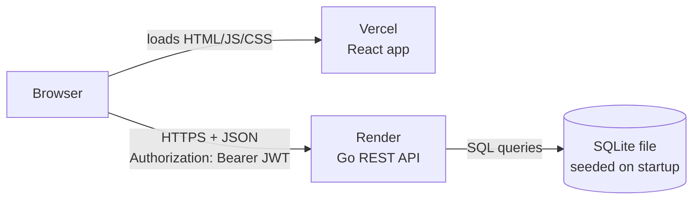
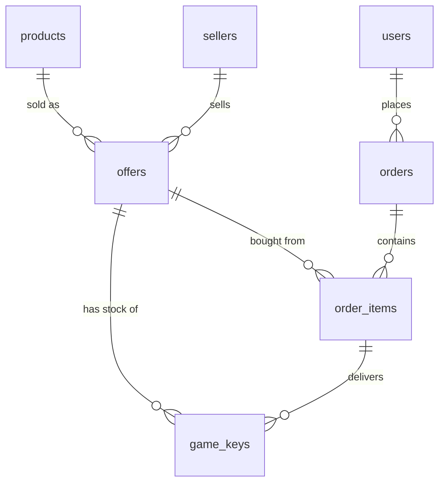

# Architecture: Eneba-style Marketplace

Homework for the Eneba Software Engineering Internship.
Monorepo: `/frontend` (React + TypeScript + Vite) and `/backend` (Go + SQLite).

---

## 1. How the pieces talk to each other



Same idea in plain text:

```
 Browser ──(1) download app──▶ Vercel (static React files)
    │
    └──(2) fetch("/api/...") JSON ──▶ Render (Go API) ──▶ SQLite (data.db)
```

**How it works, step by step**
1. The user opens the site. Vercel sends the React app (just HTML, JS and CSS files).
2. The React app runs **in the browser** and asks the Go API for data, e.g. `GET /api/products`.
3. The Go API runs SQL on SQLite and replies with JSON.
4. React turns that JSON into what you see on screen.

**Key decisions**
| Decision | Why |
|---|---|
| Go standard library `net/http` router (Go 1.22+) | Supports `GET /api/products/{slug}` out of the box. No framework to learn or explain. |
| `mattn/go-sqlite3` driver | The most widely used Go SQLite driver, hosted on GitHub. It wraps SQLite's C code, so the build needs a C compiler (CGO). Render's build image has one. *Changed on Day 1: the planned pure-Go `modernc.org/sqlite` couldn't be downloaded in our build workspace.* |
| Only 2 Go libraries besides the driver: `golang-jwt/jwt` and `x/crypto/bcrypt` | Login tokens and password hashing are security code. We use proven libraries instead of writing our own. |
| React Router for pages, plain `fetch` for API calls | No extra state library. Login state and the cart live in React Context (a shared "global variable" for components). |
| Plain CSS with CSS variables for Eneba colors | Easy to read. One place to change the theme. |
| CORS allows only the Vercel domain | The browser blocks other websites from calling our API with the user's token. |

**Backend folder layout (planned)**
```
backend/
  main.go              config from env vars, routes, starts the server
  db/db.go             opens a fresh SQLite file, runs schema, seeds
  db/schema.sql        CREATE TABLE statements (embedded into the binary)
  db/seed.go           inserts the sample data (fixed random seed = same data every start)
  db/seed_data.go      the sample catalog itself: games, gift cards, sellers, banners
  handlers/            one file per area: products.go, covers.go, later auth.go, orders.go, home.go
  search/search.go     typo-tolerant search (+ search_test.go)  [Day 3]
  middleware/          CORS, logging, later auth check
```

---

## 2. Data model



| Table | Key fields | Notes |
|---|---|---|
| **products** | id, slug, title, platform, region, genre, description, image_url, msrp_cents, release_date, sales_count | One row = one sellable variant, e.g. "Elden Ring (PC) Steam Key GLOBAL". Like Eneba, platform and region are part of the product. `msrp_cents` is the official price, used to calculate discounts. `sales_count` = popularity (best sellers, search tie-breaks). |
| **sellers** | id, name, rating_percent, sales_count | Fake marketplace sellers. |
| **offers** | id, product_id → products, seller_id → sellers, price_cents | One seller's price for one product. UNIQUE(product_id, seller_id). |
| **game_keys** | id, offer_id → offers, code, status (`available`/`sold`), order_item_id → order_items (nullable) | Pre-generated keys. **Stock = number of available keys.** A key is assigned to a buyer only after payment. |
| **users** | id, email (UNIQUE), password_hash, display_name, created_at | Passwords stored only as bcrypt hashes. |
| **orders** | id, user_id → users, status (`pending`/`paid`/`failed`), total_cents, created_at, paid_at | |
| **order_items** | id, order_id → orders, offer_id → offers, quantity, unit_price_cents, product_title | Price and title are **copied** at purchase time, so history stays correct if prices change later. |
| **banners** | id, title, subtitle, image_url, link_url, position | Content for the homepage banner block. |
| **homepage_blocks** | id, type (`banner`/`product_row`), title, endpoint, position, is_active | Defines **which** blocks the homepage shows, in what order, and where each one gets its data. |

**Rules for the whole model**
- **Money is stored as integer cents** (`1999` = €19.99). Floats give rounding errors: in Python `0.1 + 0.2 == 0.30000000000000004`.
- **No carts table on purpose.** The cart lives in the browser (`localStorage`). Guests can add items without an account, like on Eneba. At checkout the server rechecks every price and stock count, so the browser is never trusted.
- Foreign keys are switched on (`PRAGMA foreign_keys = ON`). SQLite does not enforce them by default.

---

## 3. REST API

All paths start with `/api`. All bodies are JSON. 🔒 = needs `Authorization: Bearer <token>`.

| Method | Path | Purpose | Auth |
|---|---|---|---|
| GET | `/health` | Is the server running? Used by Render. | – |
| GET | `/covers/{slug}.svg` | Generated placeholder cover image (gradient + name + platform badge) | – |
| **Homepage** ||||
| GET | `/home/blocks` | Ordered list of blocks: type, title, endpoint to call | – |
| GET | `/home/banners` | Banner slides | – |
| GET | `/home/best-sellers?limit=12` | Products ranked by sales | – |
| GET | `/home/deals?limit=12` | Products with the biggest discount vs MSRP | – |
| **Catalog** ||||
| GET | `/products?q=&platform=&region=&genre=&min_price=&max_price=&sort=&page=` | Store listing, 24 per page. `platform`/`region`/`genre` can repeat (OR within one filter, AND between filters). Prices in **whole euros**. `sort` = `popular` (default), `price_asc`, `price_desc`, `discount`, `newest`, `relevance` (with `q`). Bad values → 400 | – |
| GET | `/products/filters` | Platforms, regions and genres with product counts, plus the price range, so filter options are not hardcoded | – |
| GET | `/products/{slug}` | Product details | – |
| GET | `/products/{slug}/offers` | All seller offers for it, cheapest first, with stock | – |
| GET | `/search/suggest?q=` | Top 6 matches, total count and a "did you mean" product, for the header dropdown | – |
| **Auth** ||||
| POST | `/auth/register` | Create account, returns JWT | – |
| POST | `/auth/login` | Check password, returns JWT | – |
| GET | `/auth/me` | Who am I? (used on page reload) | 🔒 |
| **Cart and orders** ||||
| POST | `/cart/quote` | Send cart items, get current prices, stock and total | – |
| POST | `/orders` | Create a `pending` order from the cart (server recalculates prices) | 🔒 |
| POST | `/orders/{id}/pay` | Simulated payment. On success, assigns keys | 🔒 |
| GET | `/orders` | My order history | 🔒 |
| GET | `/orders/{id}` | One order with its keys (owner only) | 🔒 |

Errors always look the same: `{"error": "human readable message"}` with the right HTTP status (400, 401, 404, 409, 500).

---

## 4. Features done extensively

### A. Typo-tolerant search
Eneba's search is how people find games. Typos are common ("wticher", "cyberpnk").

How it works (`backend/search/`, our own code, no search engine; built and tested on Day 3):
1. **Normalize**: lowercase, strip accents, punctuation splits words. `"Pokémon Scarlet"` → `pokemon scarlet`.
2. **Extra word forms in titles**: joined neighbours (`spider man` → also `spiderman`, `baldur s` → `baldurs`) and Roman numerals as numbers (`V` → also `5`). The word `key` is ignored (it's in every title).
3. **Nicknames** in the query: `gta`, `cod`, `rdr2`, `bg3`, `ff7`, `totk`, ... are expanded to the full words.
4. **Every query word must match** some title word (AND), scored:
   - exact word → 10 · prefix (`cyber` → `cyberpunk`) → 7
   - 1 typo → 5 · 2 typos → 3 · half-typed word with a typo (`hogwrt` → `hogwarts`) → 2
   - Typos are measured with **Damerau-Levenshtein** distance (insert, delete, replace, *or swap two neighbouring letters* = 1 edit).
   - Allowed typos grow with word length: **1–3 letters: 0, 4–6: 1, 7+: 2**. Short words must be exact, otherwise `cod`/`god`/`cat` match each other.
5. +5 bonus if the title starts with the query. Sort by score; ties → more popular product.
6. Results under **half of the best score are dropped**, so `star` shows Stardew Valley and Starfield but not "Pokémon **Scar**let".
7. Nothing matched → **"Did you mean"**: the product with the smallest total edit distance, if under half the letters differ.
8. The index is built **in memory at startup** (80 products), so search costs no database queries.

Where it's used:
- `GET /api/search/suggest?q=`: top 6 + total + suggestion, for the header dropdown.
- `GET /api/products?q=`: search combined with every store filter, sorted by `relevance` (best match) by default; other sorts still work.

Frontend:
- Header dropdown on every page: **debounce** (250 ms after the last key, older requests cancelled), ↑/↓ + Enter, Esc, click outside, matched words highlighted, "See all N results".
- Enter with nothing highlighted → `/store?q=...`, so search and filters work together; the search text shows as a removable chip.
- "No results" shows the "Did you mean" product, both in the dropdown and on the store page.
- Accessible: ARIA combobox pattern (screen readers announce the highlighted result).

Tests: `go test ./search` with a table of 35 real typos plus "must not match" cases; API tests on the seeded catalog; browser test of the dropdown.

### B. Checkout that cannot sell the same key twice
This is the money path, so correctness matters most.
- The server **recalculates** every price and checks stock. Prices sent from the browser are ignored.
- Payment runs inside **one database transaction**: mark keys `sold` → link them to order items → mark order `paid`. If any step fails, everything rolls back.
- Key claim uses `UPDATE game_keys SET status='sold' ... WHERE id=? AND status='available'`. If two buyers race for the last key, only one update succeeds. The other gets a clear "out of stock" error (409).
- Simulated card: any valid-looking number passes; card ending in `0002` is declined, so we can show the failure path.
- Paying the same order twice does nothing (it is already `paid`), so a double-click cannot charge twice.
- Order history page with keys, a copy button and a hidden/reveal toggle.
- Tests for: double payment, out of stock, someone else's order (404).

### C. Store catalog with filters
- Filters combine (platform + region + price range + search), all done **in SQL on the server**, with pagination.
- **Filters live in the URL** (`/store?platform=steam&sort=price_asc`), so the back button works and links are shareable.
- Filter options come from `/products/filters`, not hardcoded.
- Shows the **lowest offer price** and discount % per product, like Eneba cards.
- Loading skeletons, empty state, "clear filters" button.

Everything else (homepage, product page, auth) is done properly but without extra features.

---

## 5. Trade-offs and shortcuts (for README)

| Choice | Justification |
|---|---|
| SQLite instead of Postgres | Zero setup, one file, plenty for a demo. The SQL is standard, so moving to Postgres later is easy. |
| Database is reseeded on every start | Render's free tier has no permanent disk. Orders and accounts reset when the server restarts. Acceptable for a demo; a real app would use a managed database. |
| Simulated payment | The assignment says no real money. We still model a real flow: pending → paid/failed. |
| Cart in the browser, not the DB | Guests can shop before logging in. The server re-validates everything at checkout. |
| JWT in `localStorage`, not a cookie | Frontend and backend are on different domains, so cookies get blocked by browsers. Risk: XSS could steal the token. Mitigated by React auto-escaping, no raw HTML rendering and 24h expiry. |
| Own fuzzy search instead of Elasticsearch/Meilisearch | ~80 products fit in memory. Our code is small, testable and fully explainable. |
| Keys are pre-generated fake strings | Real keys come from publishers. Stock = available keys keeps the logic realistic. |
| No admin panel | Content (banners, blocks) is changed in the seed data. Out of scope for 7 days. |
| Render free tier sleeps after inactivity | First request after idle can take ~30–60 s. README will warn reviewers. |
| Eneba-like look, not a copy | Similar colors, spacing and components; own logo. We don't copy their assets. |
| Generated SVG covers instead of game art | We have no rights to publisher art. Covers are drawn by our API, so there's no external image host that could break during review. |
| CGO SQLite driver | Needs a C compiler at build time (Render has one). In exchange: the most battle-tested Go SQLite driver. |
| Few dependencies | Every line must be explainable in an interview. |

---

## 6. Seven-day plan

| Day | Goal | Done when |
|---|---|---|
| **1** | Monorepo, Go server skeleton, schema + seed data, `GET /products`, React app skeleton. **Deploy both to Render and Vercel today.** | Live Vercel site shows a list of products from the live API. |
| **2** | Store: filters, sort, pagination (API + page). Base Eneba styling: header, colors, product card. | Store page works with URL filters. |
| **3** | Search: fuzzy algorithm + unit tests, `/search/suggest`, header dropdown. | Typo test table passes; dropdown works on every page. |
| **4** | Product page with seller offers. Homepage blocks (banners, best sellers, deals) from their endpoints. | Homepage has no hardcoded content. |
| **5** | Auth: register, login, JWT middleware, `/auth/me`. Cart in browser + cart page + `/cart/quote`. | Protected routes redirect to login. |
| **6** | Checkout, simulated payment, key delivery, order history. Order tests. | Buy → see key → see it in history. Race/double-pay tests pass. |
| **7** | Polish: responsive layout, loading/error states, README, final deploy, test everything on the live URLs. Buffer for bugs. | Reviewer can use the live app with no setup. |

---

## Decisions (answered)
- Day 1 = Wed 11 Nov. Target submission Tue 17 Nov (official deadline Wed 18 Nov, one day buffer).
- New GitHub repo under `Rati0ed`.
- Seed: 80 products, 8 sellers, 2–5 offers per product. Real popular titles across Steam, PlayStation, Xbox, Nintendo and gift cards. Placeholder images only, no Eneba assets.
